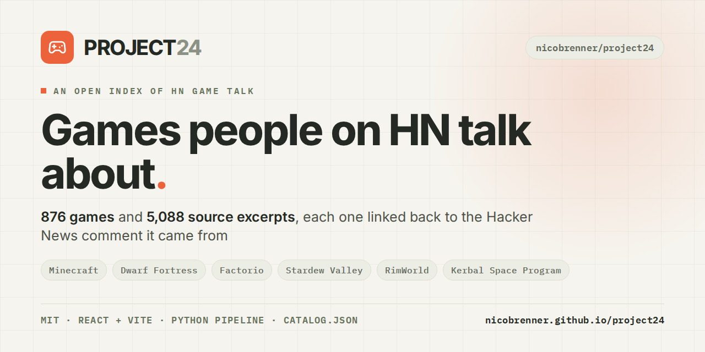

# PROJECT 24

[](https://nicobrenner.github.io/project24/)

A small, open index of games mentioned and recommended in Hacker News conversations. Browse the games, follow the discussions, and see the evidence for yourself.

[Explore PROJECT 24](https://nicobrenner.github.io/project24/) · [How it works](https://nicobrenner.github.io/project24/about/) · [Browse the data](https://nicobrenner.github.io/project24/data/catalog.json) · [Suggest a correction](https://github.com/nicobrenner/project24/issues)

---

## What's here

- **Video games and tabletop games.** Search, filter, and browse each collection separately. Video games are the main catalog; tabletop is an early pilot.
- **Conversations, in context.** Every indexed mention links to its original HN comment or submission. Game pages distinguish reviewed recommendations, unreviewed candidates, mentions, criticism, and technical discussion.
- **Ways to explore.** Browse by reviewed recommendations or discussion count, find browser games and Show HN launches, and follow links to videos, streams, communities, and reviews elsewhere.
- **A look inside.** A reproducible Python pipeline builds a static catalog served by a React, TypeScript, and Vite frontend. No backend or runtime credentials are needed.

The checked-in snapshot has **859 video games** and **16 tabletop games**. It contains 5,087 game–source records, including 50 game–comment endorsements reviewed by Codex. A comment can appear under more than one game; these numbers are not counts of unique people or a census of HN.

## Run it locally

You'll need Node.js 22+ and Python 3.10+.

```sh
git clone https://github.com/nicobrenner/project24.git
cd project24
npm ci
npm run dev
```

Open the local URL Vite prints. The checked-in catalog works immediately, without an API key, database server, or network fetch during the build.

```sh
npm test         # pipeline and data-integrity tests
npm run build    # production build in dist/
npm run preview  # preview the production build locally
```

## How the evidence works

A game mention is a starting point, not an endorsement. Each record keeps its HN item ID, source URL, parent discussion, classification, confidence, and provenance.

| Signal | What it means |
| --- | --- |
| **Reviewed recommendations** | Positive endorsements of a particular game, individually reviewed against the source text by Codex. These are AI reviews, not independent human verification, and count comments rather than people. |
| **Discussion threads** | Distinct HN discussions represented in the collected sample. They can include criticism and technical discussion. |
| **Raw keyword matches** | Unverified search estimates before disambiguation. They are not recommendation counts; an em dash means no estimate is available. |
| **Conversation topics** | Experimental suggestions from [Jeffy](https://jeffyclassify.com/). They describe the excerpt and are not verified game attributes or endorsements. |
| **Tone indicators** | Experimental phrase-cue signals, separate from Jeffy and recommendation review. They can miss context, negation, and sarcasm. |

The source archive samples whole days, mostly from 2008–2026, so its coverage is uneven and not an exhaustive history of HN. Rankings reflect the selected evidence and review effort. Some games have no reviewed recommendations even if people discuss them often. [Read the full methodology](https://nicobrenner.github.io/project24/about/).

## Data and pipeline

The video-game index draws on a user-supplied sample of 1,191,935 HN comments and 293,708 submissions, 35 additional discussion threads, and bounded HN Algolia searches. Curated identities and contextual checks help disambiguate titles; each accepted mention retains a link to its source. The archive files themselves are local inputs and are not included in the repository.

The tabletop pilot is a separate, manually selected set of **16 games and 37 game–comment matches from 28 distinct comments**. Seven game–comment endorsements are source-reviewed by Codex. The pilot is not comprehensive and is not updated by the video-game collector. Jeffy topic labels have not yet been run on the new tabletop excerpts.

```sh
# Rebuild SQLite and the published catalog from checked-in evidence, offline
python3 -m pipeline.ingest export

# Collect a bounded video-game sample or merge incremental results
python3 -m pipeline.ingest collect --pages 1
python3 -m pipeline.ingest collect --incremental --pages 5

# Rebuild the tabletop pilot from the original sampled comments, if available
python3 -m pipeline.tabletop --comments /path/to/comments_sample.jsonl.gz
python3 -m pipeline.sentiment
python3 -m pipeline.ingest export
```

The [pipeline guide](pipeline/README.md) covers the schema, source reviews, rate limits, archive discovery, and classifier limitations. [Tabletop selections](data/tabletop-selections.json), [review decisions](data/reviews.json), and [classifier metadata](data/classifiers/) are versioned for inspection. The scheduled **Update HN evidence** workflow performs bounded video-game collection; it does not create reviewed recommendations or expand the tabletop pilot.

## Deploy

### GitHub Pages

The live site is hosted at [nicobrenner.github.io/project24](https://nicobrenner.github.io/project24/). The included [GitHub Pages workflow](.github/workflows/github-pages.yml) builds for the `/project24/` path, generates direct game-page entry points, and deploys pushes to `main`.

For a new repository, enable **Settings → Pages → Build and deployment → GitHub Actions**. If you use a different repository name, update the GitHub Pages base path in `vite.config.ts` to match it. A custom domain can be configured in GitHub Pages settings.

The route generator also writes canonical URLs and per-game social-preview tags. It defaults to the GitHub Pages URL; when building for another host, set its public URL before running the generator:

```sh
SITE_URL=https://example.com node scripts/generate-pages-routes.mjs
```

### Cloudflare Pages

Connect the repository to Cloudflare Pages with production branch `main`, build command `npm run build`, output directory `dist`, and Node.js 22. The included `_redirects` supports direct game routes. A manual [Cloudflare deployment workflow](.github/workflows/deploy.yml) is also available if the Pages project and the required account ID and API-token secrets are configured; its project name is currently `hackergames`.

## Project map

```text
src/                 React interface and styles
public/data/         Static catalog served by the site
pipeline/            Collection, review, export, and tests
data/                Versioned evidence, selections, reviews, and classifier metadata
.github/workflows/   Validation, collection, and deployment workflows
```

## Help improve the collection

Found a bad match, missing game, or confusing source? [Open an issue](https://github.com/nicobrenner/project24/issues) with a link to the HN discussion if you have one. New evidence is welcome; please keep mentions separate from reviewed recommendations and preserve the original source links.

There is plenty still to do: broader historical coverage, more independently reviewed recommendations, improved alias disambiguation, source-deletion reconciliation, and independent evaluation of the experimental classifiers.

## Rights and independence

The project's original code is available under the [MIT License](LICENSE). HN comments belong to their authors and link to their originals. Game artwork and metadata remain with their respective rights holders; externally hosted artwork is attributed on game pages and is not relicensed by this repository. Tabletop fallback artwork is generated by the site. Remote artwork requests reveal normal browser request information to the image host.

The site loads Google Analytics and Umami scripts, including an Umami recorder, and records page views and outbound-link interactions. These services also receive normal browser request information.

PROJECT 24 is independent and is not affiliated with Hacker News, Y Combinator, Valve, or game publishers. It was inspired by HackerBooks, HackerTube, and Wikihack.
